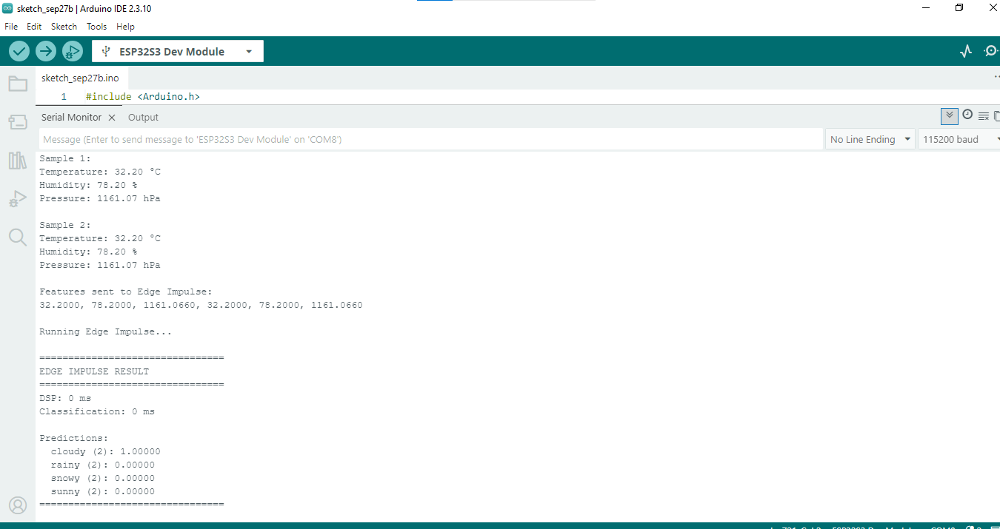
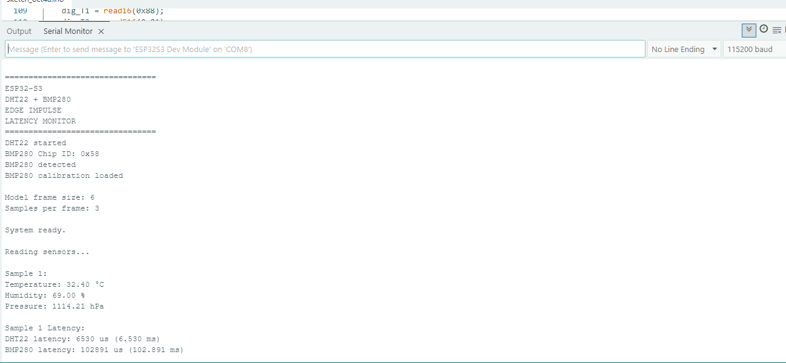
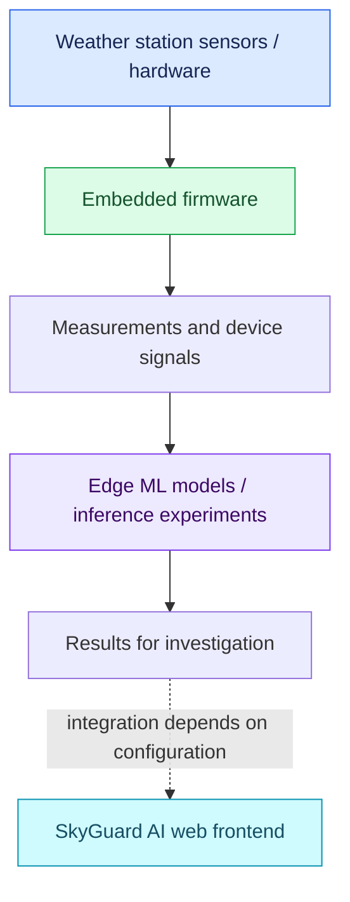

<div align="center">

#  SkyGuard AI
### **See the weather. Understand the signals. Protect the station.**

An intelligent Automatic Weather Station (AWS) project combining a modern web interface, embedded firmware, and edge machine-learning experiments to make sensor monitoring easier to understand and maintain.

<br />

[](https://react.dev/)
[](https://vite.dev/)
[](https://www.arduino.cc/)
[](https://www.edgeimpulse.com/)

**[Overview](#-the-big-picture) · [Features](#-what-makes-it-special) · [Architecture](#-how-the-pieces-fit-together) · [Setup](#-get-it-running) · [Hardware](#-hardware--firmware) · [Roadmap](#-the-road-ahead)**

</div>

---

## 🌍 The big picture

Weather data is only useful when we can trust it. **SkyGuard AI** explores how an Automatic Weather Station can pair sensor measurements with accessible visualisation and embedded intelligence to help people investigate unusual readings, communication delays, and potential sensor issues.

> [!NOTE]
> This repository contains a React + Vite frontend, Arduino-compatible firmware examples, and Edge Impulse/TensorFlow Lite assets. The exact functionality available at runtime depends on your selected hardware, model, and configuration. A complete live-data pipeline or cloud service should not be assumed to be configured out of the box.

## ✨ What makes it special

<table>
<tr>
<td width="50%" valign="top">

### 📊 A modern web interface

A React-powered interface built with Vite, with reusable UI components and Lucide icons.

</td>
<td width="50%" valign="top">

### 🔌 Embedded experiments

Arduino sketches for sensor/device experiments, including sensor monitoring and latency-related work.

</td>
</tr>
<tr>
<td width="50%" valign="top">

### 🧠 Edge machine learning

Edge Impulse inference assets and TensorFlow Lite model files for on-device experimentation.

</td>
<td width="50%" valign="top">

### 🔎 Reliability-focused thinking

Explore unusual patterns, delayed readings, and possible sensor malfunction—then validate them against real measurements.

</td>
</tr>
</table>

## 🖼️ Inside the project

<div align="center">

| Station overview | Circuit reference |
|:---:|:---:|
|  |  |
| *Project / station visual* | *Hardware wiring reference* |

| Communication failures | Latency experiment |
|:---:|:---:|
|  |  |

</div>

## 🧩 How the pieces fit together



The diagram illustrates the **intended high-level relationship** between hardware, firmware, model inference, and the web interface. The dashed connection represents integration that may still need to be implemented or configured.

## 🧰 Technology at a glance

| Layer | Tools and technologies | Purpose |
|---|---|---|
| Frontend | React, React DOM, Vite | Web interface and development server |
| UI icons | Lucide React | Interface iconography |
| Firmware | Arduino sketches, C/C++ | Hardware and sensor experiments |
| Edge AI | Edge Impulse, TensorFlow Lite assets | Embedded inference experiments |
| Visual documentation | PNG diagrams and illustrations | Wiring and experiment references |

## 📁 Project map

```text
AWS/
├── Backend/
│   ├── edge_sensor.ino
│   ├── Anomaly Detection/
│   │   ├── examples/          # Board-specific inference examples
│   │   └── src/               # SDK, model parameters and model assets
│   ├── Sensor Malfunction/
│   │   ├── sensor_latency.ino
│   │   ├── model-parameters/
│   │   └── tflite-model/
│   └── src/
├── Frontend/
│   └── SkyGuard-AI-Frontend/
│       ├── src/
│       │   ├── App.jsx
│       │   ├── main.jsx
│       │   └── styles.css
│       ├── index.html
│       ├── package.json
│       └── vite.config.js
├── Pictures/                  # Station, circuit and experiment visuals
└── README.md
```

> **Tip:** Choose firmware examples that match your actual board and sensors. The Edge Impulse examples may target different devices, so they are not necessarily interchangeable.

## 🚀 Get it running

### Prerequisites

- [Node.js](https://nodejs.org/) — use an LTS release
- npm — included with Node.js
- [Arduino IDE](https://www.arduino.cc/en/software) for firmware development
- A supported microcontroller, compatible sensors, required libraries, and board support package

### 1 · Get the code

```bash
git clone <YOUR_REPOSITORY_URL>
cd AWS
```

Replace `<YOUR_REPOSITORY_URL>` with your repository's actual Git URL. If you already downloaded the project, open a terminal in the project root instead.

### 2 · Launch the frontend

```bash
cd Frontend/SkyGuard-AI-Frontend
npm install
npm run dev
```

Open the local address printed in your terminal by Vite (often `http://localhost:5173`).

**Create a production build**

```bash
npm run build
npm run preview
```

### 3 · Prepare the firmware

1. Open the relevant `.ino` file in Arduino IDE.
2. Select the correct board and serial port.
3. Install the libraries required by that specific sketch.
4. Match the wiring and pin assignments to the code and hardware.
5. Compile, upload, and open Serial Monitor at the baud rate specified in the sketch.
6. Compare readings with a known reference wherever possible.

## 🔌 Hardware & firmware checklist

Before powering up, verify:

- [ ] Board model and logic-voltage compatibility
- [ ] Sensor power, ground, and signal connections
- [ ] Pin assignments against the selected sketch
- [ ] Required Arduino libraries and model files
- [ ] Correct serial baud rate and readable output
- [ ] Sensor readings checked against a known reference

See [`Pictures/circuit diagram.png`](Pictures/circuit%20diagram.png) and the other images in [`Pictures/`](Pictures/) for project-provided visual references.

## 🧠 A responsible approach to edge AI

The repository includes model and inference assets for embedded experimentation. For meaningful, reproducible results, document the following for each model:

- **Training data:** source, coverage, and known limitations
- **Input format:** sampling rate, window size, features, and preprocessing
- **Decision logic:** threshold, output labels, and handling of uncertain results
- **Evaluation:** test conditions, false positives, false negatives, and performance
- **Deployment:** target board, memory requirements, and model version

> A model prediction is a signal to investigate—not proof that a sensor has failed. Validate alerts against raw readings, hardware checks, and real operating conditions.

## 🗺️ The road ahead

- [ ] Document supported weather parameters and sensor specifications
- [ ] Add board-specific wiring tables and setup photographs
- [ ] Define the firmware-to-application communication protocol
- [ ] Connect real station data to the frontend
- [ ] Add measurement history, trends, and connection status
- [ ] Add configurable alerts for missing, delayed, or unusual readings
- [ ] Document model training, evaluation, and deployment
- [ ] Add automated tests and a troubleshooting guide

## 🐛 Quick troubleshooting

| Problem | First things to check |
|---|---|
| Frontend will not start | Confirm Node.js/npm are installed; run `npm install` inside the frontend directory. |
| Build fails | Read the first error in the terminal and verify dependencies. |
| Firmware will not compile | Check board selection, library versions, and inference assets. |
| No sensor readings | Check power, ground, signal pins, sensor compatibility, and baud rate. |
| Model output seems wrong | Verify sampling rate, feature format, preprocessing, and model configuration. |
| Readings arrive late | Check sampling intervals, serial communication, sensor response time, and latency logic. |

## 🤝 Contributing

Ideas, fixes, documentation, and experiments are welcome.

1. Fork the repository.
2. Create a focused branch: `git checkout -b feature/your-feature`.
3. Make your changes and test the relevant frontend or hardware setup.
4. Commit with a clear message: `git commit -m "Describe your change"`.
5. Push the branch and open a Pull Request explaining what changed and how it was tested.

For firmware contributions, include the target board, wiring assumptions, required libraries, and sample serial output when useful.

## 👨‍💻 Project author

<div align="center">

### **Biswajit Biswas**

[](https://github.com/BB07070)
[](https://linkedin.com/in/biswajit-biswas-b87473377)

</div>

## 📄 License

No root-level license file was identified in the supplied project archive. Add a `LICENSE` file before distributing this project under a specific open-source license.

---

<div align="center">

### 🌤️ Better monitoring. Smarter insights. More reliable stations.

*Built with curiosity, code, sensors, and a little AI.*

**If this project interests you, consider giving the repository a ⭐ on GitHub.**

</div>
